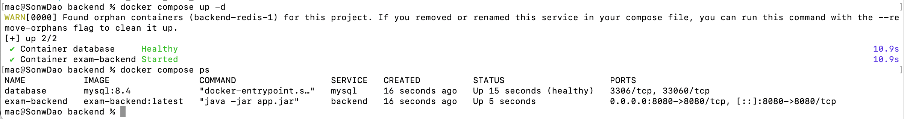
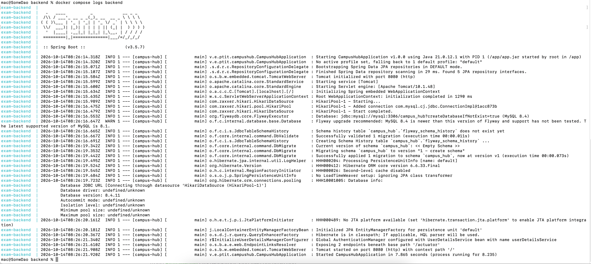
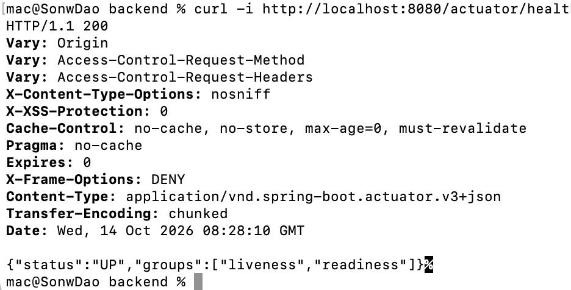

- Họ và tên : Đào Trường Sơn
- Lệnh để chạy hệ thống :
  - Tại thư mục `backend`, chạy:

```bash
bash gradlew --no-daemon clean bootJar
docker compose up -d --build
docker compose ps
```

- URL để kiểm tra backend : http://localhost:8080/actuator/health

- Minh chứng :
- backend và database chạy :
  

- backend kết nối được với database :
  

- Endpoint /actuator/health trả về HTTP 200 và trạng thái UP :
  
